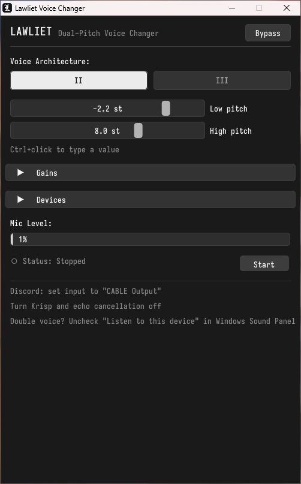
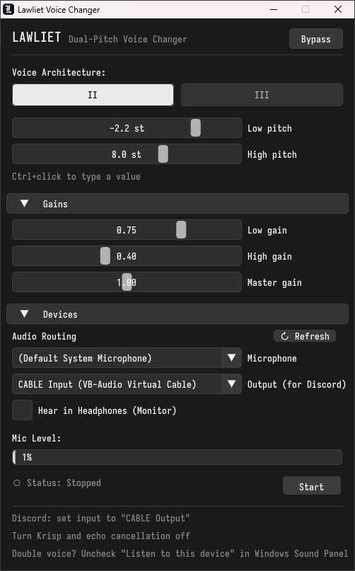

<div align="center">
  
  <h1>Lawliet</h1>
  <p>Lawliet is a lightweight Windows voice changer that layers a lower and a higher pitch copy of your voice, inspired by L from <em>Death Note</em>.</p>
  <br />
  <p>
    
    &nbsp;&nbsp;
    
  </p>
</div>

## Installation & Downloads

Pre-built ready-to-use releases for Windows 10/11 (64-bit) are available in [`release/`](release/) and on [GitHub Releases](https://github.com/aeneex/lawliet/releases):

- **[Lawliet-Setup.exe](release/Lawliet-Setup.exe):** Native Windows GUI installer. Installs to `%LOCALAPPDATA%\Programs\Lawliet`, creates Start Menu and Desktop shortcuts, and registers an uninstaller in Windows Apps & Features.
- **[Lawliet-v0.1.0-Windows-x64-Portable.zip](release/Lawliet-v0.1.0-Windows-x64-Portable.zip):** Portable ZIP package (no installation required).
- **[lawliet.exe](release/lawliet.exe):** Direct standalone portable executable.

## Requirements

- Windows 10 or Windows 11 (64-bit)
- [VB-Audio Virtual Cable](https://vb-audio.com/Cable/) (free audio loopback driver)

## Building from Source

Build offline using the provided batch script or CMake presets:
```cmd
build.bat
```
Or via CMake:
```cmd
cmake --preset windows-release
cmake --build --preset windows-release
```
Debug preset with test suite: `cmake --preset windows-debug && cmake --build --preset windows-debug`.

## Audio Routing & Setup

1. **Lawliet:** Select your microphone under **Microphone**, and set **Output** to `CABLE Input (VB-Audio Virtual Cable)`.
2. **Discord / Games:** Set your input device to `CABLE Output (VB-Audio Virtual Cable)`.
3. **Discord Voice Settings:** Turn **Krisp noise suppression OFF**, turn **Echo Cancellation OFF**, and set input sensitivity manually to around `-55 dB` to `-60 dB`.
4. **Headphone Monitoring:** Optional live preview is available via **Hear in Headphones**. Always use headphones when monitoring to prevent acoustic feedback into your mic.

## Voice Architecture

- **Mode II (Dual Pitch):** Mixes a low pitch layer (-12.0 to 0.0 st) and a high pitch layer (0.0 to +12.0 st).
- **Mode III (Three Layers):** Mixes the low and high pitch layers with delay-aligned direct dry speech.
- **Latency:** Measured DSP impulse peak latency is ~23.2 ms (1,024 frames @ 44.1 kHz).

## Configuration

Settings are saved automatically to `lawliet.ini` next to the executable (debounced on change and persisted on exit).

## Licenses

- **SoundTouch:** LGPL 2.1 ([external/soundtouch/LICENSE.txt](external/soundtouch/LICENSE.txt))
- **Dear ImGui:** MIT License ([external/imgui/LICENSE.txt](external/imgui/LICENSE.txt))
- **GLFW:** zlib/libpng License ([external/glfw/LICENSE.md](external/glfw/LICENSE.md))
- **miniaudio:** Public Domain / MIT-0 ([external/miniaudio/LICENSE](external/miniaudio/LICENSE))
